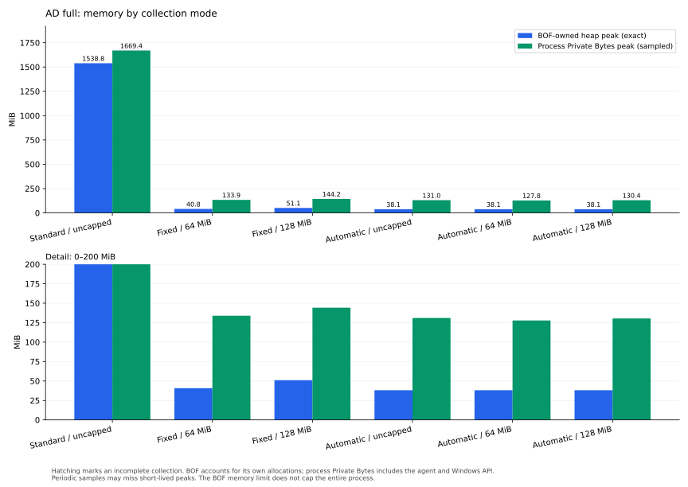
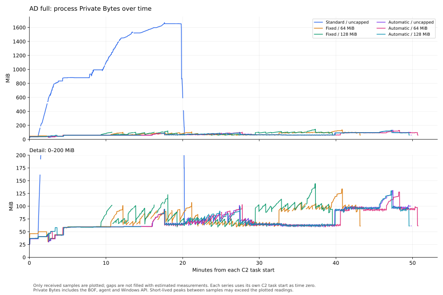

# AdaptiHound-BOF

A library of Beacon Object Files to collect Active Directory and FreeIPA graphs in AdaptixC2.
Supports Windows x64 beacon and gopher agents. Results are sent to Downloads as ZIP archives or individual JSON files.


## Build

Requires MinGW-w64 with `x86_64-w64-mingw32-g++` and `x86_64-w64-mingw32-strip`.

```sh
make
```

Use `make ad` or `make freeipa` to build one collector. Output files are `_bin/AdaptiHound/ad.x64.o` and `_bin/AdaptiHound/freeipa.x64.o`.

Load `postex.axs` through the AdaptixC2 AxScript manager. It imports `adaptihound.axs`, which connects the AD and FreeIPA command scripts.


## Structure

```text
postex.axs         AxScript entry point
adaptihound.axs    Shared arguments and command group
ADHound-BOF/
  ad.axs           Active Directory command
  src/
    core/          AD object model, settings and runtime
    collection/    LDAP producers, queries and target input
    graph/         BloodHound objects, relationships and output
    host/          Host probes, sessions and local groups
    registry/      Remote registry collection
    cache/         AD lookup cache
IPAHound-BOF/
  freeipa.axs      FreeIPA command
  src/
    core/          FreeIPA object model and runtime
    graph/         OpenGraph objects and relationships
  schema/          BloodHound graph definition
common/
  core/            Memory, arguments, logging and API imports
  ldap/            Shared LDAP transport and directory storage
  output/          JSON, ZIP and Downloads output
_include/          Bundled BOF API headers
mk/                Shared Make rules
```

Each collector has its own `src/entry.cpp` and `src/collector.cpp`. The FreeIPA build does not depend on AD collection modules.


## adaptihound ad

Collect Active Directory objects, memberships, ACLs, trusts, GPOs, certificate services and computer relationships.

```
adaptihound ad [--server DC] [--domain DOMAIN] [--collection METHODS] [--kerberos] [--ldaps]
```

* `--server` - Domain Controller FQDN (auto-detected if not specified)
* `--domain` - Domain to enumerate (current domain by default)
* `--searchforest` - Enumerate all domains in the forest
* `--recursedomains` - Recursively enumerate trusted domains
* `--base-dn` - LDAP search base (discovered from RootDSE by default)
* `--collection` - `default`, `dconly`, `computeronly`, `full`, `all`, `none`, or comma-separated collection methods
* `--kerberos` - Use Kerberos for LDAP authentication without NTLM fallback
* `--ldaps` - Require LDAPS
* `--port` - Plain LDAP port (389 by default)
* `--ssl-port` - LDAPS port (636 by default)
* `--ldap-username`, `--ldap-password` - Alternate LDAP credentials
* `--bind-dn`, `--password` - Explicit simple-bind credentials (requires `--ldaps`)
* `--disable-signing` - Disable signing and sealing on the plain LDAP fallback
* `--disable-cert-verification` - Disable LDAPS certificate validation
* `--ldap-filter` - Additional LDAP filter
* `--partition-ldap-queries` - Partition main LDAP queries by the first GUID byte
* `--page-size` - Entries per LDAP page (500 by default, maximum 1000)
* `--collect-all-properties` - Export additional readable LDAP attributes
* `--computers` - Comma-separated host targets for computer collection
* `--computer-file` - Read host targets from an operator-side file
* `--computer-file-agent` - Read host targets from a file on the collecting Windows host
* `--skip-registry-loggedon` - Skip HKEY_USERS session enumeration
* `--local-admin-session` - Use alternate local credentials for session enumeration
* `--local-admin-username`, `--local-admin-password` - Credentials for `--local-admin-session`
* `--override-username` - Accept the SharpHound compatibility option; the pinned session processor ignores it
* `--real-dns-name` - DNS suffix fallback when dNSHostName is absent
* `--throttle`, `--jitter` - Delay between computer requests in milliseconds and jitter percentage
* `--threads` - Concurrent object and host collectors (50 by default)
* `--extended-sessions` - Also collect WTS and WMI sessions
* `--conservative-probes` - Require additional evidence when classifying LDAP and HTTP policies
* `--skip-port-scan` - Skip the computer TCP 445 availability check
* `--skip-password-age-check` - Include computers with old password and logon timestamps
* `--port-scan-timeout` - TCP availability timeout in milliseconds (10000 by default)
* `--stealth` - Apply SharpHound 2.17.1 Stealth producer and method behavior
* `--exclude-dcs` - Skip ancillary Stealth DC discovery; ordinary DC collection remains enabled
* `--loop` - Repeat session, LoggedOn and local-group collection
* `--loop-duration` - Loop duration as a TimeSpan, such as `00:05:00` (zero selects two hours)
* `--loop-interval` - Delay between passes as a TimeSpan (zero selects 30 seconds)
* `--loop-duration-seconds`, `--loop-interval-seconds` - Integer-seconds aliases
* `--track-computer-calls` - Write computer collection status to CSV
* `--cache-name` - Lookup-cache path on the agent
* `--memcache` - Load an existing cache without creating or overwriting its file
* `--rebuild-cache` - Accept the compatibility flag; unused in SharpHound 2.17.1
* `--metrics` - Export LDAP metrics to Downloads independently of console telemetry

Collection methods include `group`, `localadmin`, `gpolocalgroup`, `session`, `loggedon`, `trusts`, `acl`, `container`, `rdp`, `dcom`, `psremote`, `objectprops`, `spntargets`, `userrights`, `caregistry`, `dcregistry`, `certservices`, `ldapservices`, `webclientservice`, `smbinfo`, `ntlmregistry`, `site` and `azureregistry`. Use `localgroup` to select the four local-group methods.

```
adaptihound ad --collection full
adaptihound ad --server dc.example.org --kerberos --collection dconly
adaptihound ad --collection session --computers workstation.example.org
```

AD output uses BloodHound v6 JSON. Collection behavior targets SharpHound 2.17.1 with SharpHoundCommon and SharpHoundRPC 4.9.1 (Stable), including repeated producer rows and the distinction between missing, null and empty values. Standard collection with the `None` method produces an empty ZIP unless `--no-zip` is set. Batched collection with `None` produces no data parts and reports zero parts in its manifest.

Import the AD ZIP or individual JSON files with BloodHound CE's native AD importer. AD data does not require a custom graph definition. An empty `None` archive contains no data to import.

Explicit empty strings are preserved, including `--output-prefix ""` and empty credential values. An empty computer-file path is rejected. An explicitly empty LDAP filter follows SharpHound's normalization to `()` and produces an LDAP filter error; omit the flag to use the generated filter alone.


## adaptihound freeipa

Collect FreeIPA users, groups, hosts, services, HBAC, sudo rules, permissions and trust relationships.

```
adaptihound freeipa --server SERVER --ldaps --bind-dn BIND_DN --password PASSWORD [--base-dn BASE_DN]
```

* `--server` - FreeIPA LDAP server FQDN (required)
* `--ldaps` - Use LDAPS (required)
* `--bind-dn` - LDAP bind distinguished name (required)
* `--password` - Bind password (required)
* `--base-dn` - LDAP search base (discovered from RootDSE by default)
* `--port` - LDAPS port (636 by default)
* `--page-size` - Entries per LDAP page (500 by default, maximum 1000)

FreeIPA always collects its complete configured set of object types. The shared `--collection` option is accepted for compatibility and does not select FreeIPA datasets. AD authentication, host collection, cache and forest traversal options are unavailable for this command.

```
adaptihound freeipa --server ipa.example.org --ldaps --bind-dn "uid=auditor,cn=users,cn=accounts,dc=example,dc=org" --password PASSWORD
```

FreeIPA output uses OpenGraph JSON. Install [ipahound-graph-definition.json](IPAHound-BOF/schema/ipahound-graph-definition.json) for the IPA node and edge definitions.

Update the installed graph definition to v1.1.0 for the `IPAHound` source kind and netgroup kinds used by the collector.

Node properties retain IPAHound's scalar types and newline-separated multivalued attributes. References to unreadable directory objects remain in the graph with their names and identifiers. Explicit sudo and CA ACL group targets remain group endpoints, and repeated rule relationships are preserved.


## Output options

Available for both collectors unless marked AD-only.

* `--output` - Base ZIP filename in Downloads; timestamp and optional prefix are still added
* `--output-prefix` - Prefix output filenames
* `--random-filenames` - Use random output filenames
* `--pretty-print` - Indent JSON output
* `--no-zip` - Send individual JSON files to Downloads
* `--zip-password` - Protect the ZIP archive with a password
* `--max-mib` - Hard ceiling for the BOF's own live heap allocations in MiB; 0 leaves them uncapped
* `--memory-auto` - AD-only: economical streaming with memory allocated as needed; `--max-mib` is optional
* `--telemetry` - Show detailed console diagnostics, progress and memory statistics
* `--status-interval` - Telemetry status interval in milliseconds (30000 by default)
* `--verbosity` - Log threshold from 0 (Trace) to 6 (None), default 2 (Information); detailed diagnostics also require `--telemetry`

Default ZIP filenames:

| Command | Filename |
|---|---|
| `adaptihound ad` | `YYYYMMDDHHMMSS_adaptihound-ad-<domain>.zip` |
| `adaptihound freeipa` | `YYYYMMDDHHMMSS_adaptihound-freeipa-<domain>.zip` |

The domain is lowercase and the timestamp uses the collecting Windows host's local time. `--output-prefix PREFIX` adds `PREFIX_` before the timestamp. `--random-filenames` replaces the base filename and extension with random characters while retaining the timestamp and optional prefix.

With `--no-zip`, standard AD collection sends one JSON file per exported dataset, while batched AD collection can send several JSON parts for a dataset. FreeIPA sends one `YYYYMMDDHHMMSS_freeipa_graph.json` file. The same prefix and random-filename options apply.

Decrypt password-protected ZIPs and import the extracted JSON files. Standard AD loop output includes an outer ZIP containing per-pass ZIPs; extract it and import the individual pass archives. Batched loop collection emits each pass's parts directly. When using random filenames, give extracted JSON files a `.json` extension for upload.


## Console output

By default, the console shows collection start, exported entity counts (users, computers, groups and other types), warnings and errors. Counts describe exported graph records, including any placeholder principals. Multipart totals cover completed output parts; an incomplete collection is reported separately. Archive preparation messages, filenames, sizes and part totals require `--telemetry`. Use it with either collector for timestamps, LDAP and cache details, periodic progress and process memory, and BOF memory statistics:

```sh
adaptihound ad --collection full --telemetry
```

`--verbosity` filters messages within the selected output mode. Trace and debug levels require `--telemetry`. The AD-only `--metrics` option exports a metrics log to Downloads without enabling console telemetry.


## Memory modes

The following examples collect the same `full` method set. Memory settings control how the collector retains and exports the data.

| Mode | Command | How it works |
|---|---|---|
| Standard, uncapped | `adaptihound ad --collection full` | Retains the collected directory and graph in memory and produces the usual archive. Memory grows with the dataset. |
| Fixed ceiling | `adaptihound ad --collection full --max-mib 128` | Uses batches and independent ZIP parts for ordinary single-domain AD collection. All BOF-owned live heap allocations share the 128 MiB ceiling. |
| Automatic, uncapped | `adaptihound ad --collection full --memory-auto` | Uses small batches, a bounded RAM lookup cache and low concurrency. Allocates additional memory as required by individual objects, without a user-specified ceiling. |
| Automatic with a ceiling | `adaptihound ad --collection full --memory-auto --max-mib 128` | Uses the same economical pipeline and also enforces the 128 MiB ceiling on BOF-owned live allocations. |

Automatic mode uses a 32 MiB sizing basis, reduced to the requested ceiling when it is smaller. This does not preallocate 32 MiB. With no ceiling or a ceiling of at least 32 MiB, its auxiliary settings are:

| Setting | Automatic | Fixed 64 MiB | Fixed 128 MiB |
|---|---:|---:|---:|
| LDAP entries per page, maximum | 32 | 32 | 32 |
| Producer entries per batch, maximum | 128 | 128 | 128 |
| Source batch size target | 2 MiB | 4 MiB | 8 MiB |
| Lookup-cache arena limit | 4 MiB | 8 MiB | 16 MiB |
| Uncompressed JSON target per ZIP part | 4 MiB | 8 MiB | 8 MiB |
| Host worker allowance, maximum | 4 | 8 | 16 |

The requested `--page-size` and `--threads` can lower the corresponding maxima. Batched JSON objects are serialized one at a time; host concurrency also depends on the selected targets. Each batch includes additional support and GPO dependency objects. Cache hash-index arrays and allocation headers require additional memory under the overall BOF ceiling. Lookup caches are recycled between batches after borrowed references have expired. Temporary classification attributes and DN lookup filters are released after each lookup; identifiers remain valid for the graph that owns them.

One large group, its source attributes or its complete JSON record can exceed a batch or part target. The collector permits such a record up to its row and transport limits, subject to any overall heap ceiling. Automatic mode keeps the auxiliary settings small; it does not search for a mathematical minimum. Its logged working watermark rises in 1 MiB steps as allocations require it. Raising that watermark does not reserve memory or enlarge the cache, batch or worker settings.

For a fixed ceiling, the complete JSON-record size limit is one quarter of that ceiling, capped by the Downloads transport limit: 16 MiB at 64 MiB and 32 MiB at 128 MiB. Automatic mode allows a record up to the requested ceiling or transport limit, whichever is smaller, and uses the transport limit when uncapped. The overall live-heap ceiling still includes the source object, graph, record, compression and other concurrent allocations, so a record cannot consume that whole ceiling by itself.

The heap ceiling and reported BOF peak include the collector's allocation headers. Windows LDAP/NetAPI allocations, thread stacks and the agent's queued output buffers are separate. A 64 MiB BOF ceiling therefore permits a process private-byte peak above 64 MiB. Without a user ceiling, allocation can still fail when the operating system cannot satisfy a request.

### Scope and cache policy

Automatic mode supports ordinary single-domain AD collection. It rejects FreeIPA, `--stealth`, `--searchforest`, `--recursedomains`, nonempty `--computers`, `--computer-file` and `--computer-file-agent`. A fixed positive ceiling with those AD scope options uses the standard pipeline under the ceiling, with a console notice.

The batched pipeline uses a disposable RAM cache and does not load or save a persistent lookup-cache file. The standard pipeline normally loads and saves its lookup cache. `--memcache` suppresses creating or overwriting that file, but still reads an existing one. To compare cold runs without writing a cache, use `--memcache --cache-name` with a new, verified-absent path for each run.

### ZIP parts and completeness

Each part is an independent ZIP containing complete BloodHound v6 JSON records. Import every ZIP in the run; the parts do not require concatenation. With `--no-zip`, the same batched output is sent as JSON files.

The accompanying manifest records completion, per-dataset counts, part count and naming, size targets and rolling CRC32. Use it to validate the complete set of parts; do not import the manifest into BloodHound. A detected collection or allocation failure produces an incomplete manifest when it can still be emitted. A crash or termination may leave no manifest, which does not establish completeness. Already completed parts remain usable as partial results, and the unfinished active part is discarded on a detected failure.

The current agent delivers Downloads after the BOF task returns. Part generation bounds the collector's retained data, while queued copies owned by the agent remain outside the BOF heap ceiling. Calling the output API hands data to the agent without a server-delivery acknowledgement. Verify the final Downloads states and received sizes before treating transfer as complete.


## Full-domain memory benchmark

<details>
<summary>Test domain, measured results and charts</summary>

### Test domain and workload

The AD memory benchmark uses `adaptihound.test`, a single-domain forest at Windows Server 2016 functional levels. There are two real Windows Server 2022 Datacenter machines. Resource observations on 2026-11-09:

| Host | Role | Logical CPUs | RAM |
|---|---|---:|---:|
| `AH-DC01` | The only domain controller, DNS and Global Catalog | 2 | 4 GiB |
| `AH-SRV01` | Collector and services member server | 1 | 1 GiB |

Both hosts report Windows build `20348`. At preflight, the collector had a 2,472 MiB pagefile and the DC had a 1,408 MiB pagefile. The memory figures below measure allocations or process private bytes, rather than installed RAM. AD CS `CertSvc`, IIS `W3SVC`, SMB `LanmanServer`, SQL Express and WinRM were running on the member at the environment check.

The complete exported graph contains **114,343 unique typed identifiers in 114,371 rows** across 16 datasets. The extra 28 group rows are expected LDAP-record/well-known-placeholder pairs. These are graph entity counts, rather than a count of deployed machines or independent CA services.

| Exported entity type | Unique identifiers |
|---|---:|
| Users | 100,735 |
| Groups | 11,169 |
| Computers | 1,327 |
| Organizational units | 575 |
| Group Policy Objects | 102 |
| Containers | 210 |
| Certificate templates | 99 |
| Issuance policies | 68 |
| Sites | 18 |
| Subnets | 34 |
| Domain | 1 |
| Enterprise CA, Root CA, AIA CA, NTAuth store, SiteServer | 1 of each |

The Users dataset includes 100,663 ordinary LDAP users, 35 sMSA, 35 gMSA and two well-known principal placeholders. There are 11,165 LDAP group objects and four additional placeholder-only group principals. Of the computer objects, **two are real hosts and 1,325 are disabled directory fixtures**.

The workload contains **2,026,894 direct group memberships**, including 25,627 group-to-group memberships, plus 102,060 primary-group references. It exports **1,189,315 ACE entries**: 416,478 explicit and 772,837 inherited. The largest group has **100,000 direct members**; other large groups have 95,000, 65,000, 50,000, 40,000 and 25,000 members.

Collection exercises a 128-group chain, cycles and diamond nesting; Global, Universal and DomainLocal groups; Security and Distribution fixtures; member range boundaries; explicit and inherited ACLs; sMSA/gMSA retrieval permissions; and directory KCD, RBCD and unconstrained-delegation scenarios. OU distinguished names reach 33 OU components, with 11 blocked-inheritance OUs and 100 exported domain/OU GPO links. SYSVOL fixtures include GPP local groups, Restricted Groups, conflicting and enforced policies, and valid XML/UTF-16 INF files immediately below, at and above 2 MiB. A separate mutation scenario exercised rename, move and delete/recreate between snapshots.

The member provides one Enterprise Root CA with AD CS Web Enrollment over IIS HTTPS, the `AH-Lab` SMB share and SQL Server 2022 Express `16.0.1000.6`, using Windows authentication and the `AdaptiHoundLab` database. A DC-to-SQL TCP login was verified to use Kerberos. The CA publishes two templates; 64 additional collection templates remain unpublished. Policy-to-group links, enrollment ACLs, sites and subnets add Configuration NC work. The 18 sites and 34 subnets describe topology metadata; only the default site contains a DC.

The full snapshot verified host UserRights, local groups, privileged/registry sessions and the four CA registry sections. Directory fixtures do not establish actual certificate issuance, an IIS worker running as gMSA, native LAPS password backup or successful delegated KCD/RBCD authentication. This two-host lab does not cover a second DC, multiple domains or trusts, Windows workstations or multi-DC replication.

<!-- adaptihound-memory-benchmark:2026-11-09:begin -->

### Measured runs — series started 2026-11-09

One sequential run with a cold lookup cache was performed for each mode using the same elevated Windows x64 beacon process on `AH-SRV01`. Every run used `full`, Kerberos, metrics, a requested 50 workers and a requested LDAP page size of 500. Each run used a unique verified-absent cache path with `--memcache`; the actual batched settings are described above.

All runs executed the same frozen BOF, SHA256 `4c5e3f4a613aa66f143a2215ed7227de8cf1aa8dd3743565c60892ff4ff41270`. Downloads for a run use the prefix `ahmem-20261109T160317-<mode>`.

The BOF peak is its own live-allocation counter. Process Private Bytes (`PrivateMemorySize64`) were sampled every second in 50-second observation windows, with gaps between windows; the largest observed inter-sample gap for each run ranged from 5.01 to 160.02 seconds. Process peaks are sampled absolute values including the existing agent baseline, native allocations and queued output copies. Brief peaks between samples can be missed; these are not continuous peak measurements.

The sampler recorded 1 failed observation window(s); per-run failure counts and maximum gaps are retained in the raw results. Missing intervals are left as gaps in the time plot.

These are single measurements in sequence on the same process, including memory retained by the agent between runs. The operating-system and server caches were not reset between runs. These measurements demonstrate this workload and are not a statistically repeated performance comparison.

| Mode | BOF-owned heap peak, MiB | Sampled process Private Bytes peak, MiB | C2 task time (hh:mm:ss) | Result |
|---|---:|---:|---:|---|
| Standard / uncapped | 1,538.83 | 1,669.39 | 00:20:17 | Complete |
| Fixed / 64 MiB | 40.78 | 133.94 | 00:43:12 | Complete |
| Fixed / 128 MiB | 51.09 | 144.20 | 00:39:36 | Complete |
| Automatic / uncapped | 38.10 | 130.97 | 00:49:50 | Complete |
| Automatic / 64 MiB | 38.10 | 127.81 | 00:50:43 | Complete |
| Automatic / 128 MiB | 38.10 | 130.38 | 00:49:35 | Complete |


On this workload, automatic mode without a ceiling used 40.38 times less BOF-owned peak memory than standard collection, while its C2 task took 2.46 times as long. The process-level peaks are separate measurements, as shown in the table.


| Mode | ZIP parts | Total ZIP size, MiB | LDAP requests | Exported rows |
|---|---:|---:|---:|---:|
| Standard / uncapped | 1 | 33.78 | 778 | 114,371 |
| Fixed / 64 MiB | 103 | 33.84 | 1,923,867 | 114,371 |
| Fixed / 128 MiB | 103 | 33.84 | 1,749,054 | 114,371 |
| Automatic / uncapped | 180 | 33.87 | 1,986,985 | 114,371 |
| Automatic / 64 MiB | 180 | 33.87 | 1,986,985 | 114,371 |
| Automatic / 128 MiB | 180 | 33.87 | 1,986,985 | 114,371 |


Every complete run matched the baseline multiset of typed identifiers and their multiplicities: **114,371 rows, 114,343 unique typed identifiers and 28 expected repeated built-in group rows**. Each also contained **2,026,894 direct membership entries and 1,189,315 ACE entries**. ZIP integrity and, for multipart output, manifest completion and rolling CRC32 were checked. A separate comparison also matched the complete row multisets after normalizing only nonnegative integer `Properties.lastlogon` values and element order in `GPOChanges.AffectedComputers`. Field presence, every other value and array order, and repeated elements were preserved in this comparison.

Batched modes release directory and graph data between batches and may repeat dependency lookups. The LDAP-request counts expose this memory/work tradeoff. ZIP part targets refer to uncompressed JSON, so they do not predict the compressed size of each downloaded archive.





The peak chart compares categories, not a time series. The second chart shows sampled process consumption over each task's elapsed time; observation gaps do not establish the values between samples.

<!-- adaptihound-memory-benchmark:2026-11-09:end -->

</details>

## References

* [SharpHound](https://github.com/SpecterOps/SharpHound)
* [IPAHound](https://github.com/IPAHound/IPAHound)
* [AdaptixC2](https://github.com/Adaptix-Framework/AdaptixC2)
